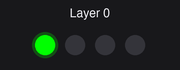
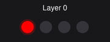
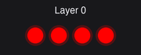

# Layer feedback

Layer feedback shows the current active layer on the LED strip and can optionally stay on continuously.
By default, it only displays the layer briefly after a layer change.

## Configuration

| Option                                                     | Default           | Description                                                                                             |
| ---------------------------------------------------------- | ----------------- | ------------------------------------------------------------------------------------------------------- |
| `CONFIG_ZMK_LED_FEEDBACK_LAYER`                            | `y`               | Enable layer feedback.                                                                                  |
| `CONFIG_ZMK_LED_FEEDBACK_LAYER_COLORS`                     | `"00FF00,FFFF00"` | Comma-separated `RRGGBB` colors for layer groups. Each color is used until the strip fills. Default     |
| `CONFIG_ZMK_LED_FEEDBACK_LAYER_COLORS_PER_LAYER`           | `""`              | Optional per-layer color palette. When set, overrides `LAYER_COLORS`                                    |
| `CONFIG_ZMK_LED_FEEDBACK_LAYER_COLORS_PER_LAYER_LED_COUNT` | `0`               | `0` Default. same as `COLORS_PER_LAYER`, `-1` lights all LEDs, `N` lights N LEDs.                       |
| `CONFIG_ZMK_LED_FEEDBACK_LAYER_ALWAYS_ON`                  | `n`               | Keep showing the active layer continuously.                                                             |
| `CONFIG_ZMK_LED_FEEDBACK_LAYER_ALWAYS_ON_LAYERS`           | `""`              | Comma-separated layer numbers (for example `"2,7"`) to keep showing even when `LAYER_ALWAYS_ON` is off. |
| `CONFIG_ZMK_LED_FEEDBACK_LAYER_DURATION_MS`                | `1000`            | How long to show the layer after a layer change.                                                        |

## Keycodes

There are two keycodes to briefly display the current layer and to toggle the continuous layer indication.

| Binding        | Action                             |
| -------------- | ---------------------------------- |
| `LF_LAYER`     | Show the current layer briefly.    |
| `LF_LAYER_TOG` | Toggle continuous layer indication |

Find more information about keycodes in the [keycodes documentation](keycodes.md)

## Layer colors

The default layer colors used by this module are green and yellow (`"00FF00,FFFF00"`). These colors will alternate if there are more layers than leds.

For example, for a dongle with 4 LEDs and the default layer colors (green and yellow):

- layers 0–3 light 1–4 green LEDs
- layers 4–7 light 1–4 yellow LEDs
- layer 8 starts again with 1 green LED.

<details>
  <summary>Show layer changes gif</summary>

Example of default layer changes for a dongle with 4 LEDs:



</details>

For example, if you assign three layer colors (green, yellow, purple) with the `CONFIG_ZMK_LED_FEEDBACK_LAYER_COLORS` option:

- layer 8 starts with 1 purple LED (new color).

Set colors in your zmk-config [`.conf`](dongle-setup.md#dongle-configuration-file) file as a comma-separated list of `RRGGBB` hex values:

```ini
CONFIG_ZMK_LED_FEEDBACK_LAYER_COLORS="00FF00,FFFF00,800080"
```

### Per-layer color

To assign a single color per layer instead, use the `CONFIG_ZMK_LED_FEEDBACK_LAYER_COLORS_PER_LAYER` option. This
overrides the default `CONFIG_ZMK_LED_FEEDBACK_LAYER_COLORS` option.

Each assigned color applies to one layer starting at layer 0. The list repeats if there are more layers than assigned colors.

For example, with only yellow and blue assigned (on a strip with at least 3 LEDs):

- layer 0 lights 1 yellow LED
- layer 1 lights 2 blue LEDs
- layer 2 lights 3 yellow LEDs (the palette repeats)

Set colors in your zmk-config [`.conf`](dongle-setup.md#dongle-configuration-file) file as a comma-separated list of `RRGGBB` hex values:

```ini
# Rainbow layer colors
CONFIG_ZMK_LED_FEEDBACK_LAYER_COLORS_PER_LAYER="FF0000,FF7F00,FFFF00,00FF00,0000FF,4B0082,9400D3"
```

<details>
  <summary>Show layer changes gif</summary>

Rainbow layer colors example for a dongle with 4 LEDs:



</details>

Use this option if your strip has few LEDs (or just one) and you want each layer to have its own color.

### Per-layer led count

This option is only applied to [Per-layer color](#per-layer-color).

To set the number of leds used for layers use the `CONFIG_ZMK_LED_FEEDBACK_LAYER_COLORS_PER_LAYER_LED_COUNT` option.

| Value | Result                                                                |
| ----- | --------------------------------------------------------------------- |
| `0`   | Default. Same amount of a leds as [Per-layer color](#per-layer-color) |
| `-1`  | Every layer, lights all LEDs of the LED strip                         |
| `N`   | Every layer lights N LEDs; N must not exceed the strip length         |

The configured value is validated at build time. Counts above the strip length fail the build.

```ini
# Rainbow layer colors
CONFIG_ZMK_LED_FEEDBACK_LAYER_COLORS_PER_LAYER="FF0000,FF7F00,FFFF00,00FF00,0000FF,4B0082,9400D3"
# Use all LEDs
CONFIG_ZMK_LED_FEEDBACK_LAYER_COLORS_PER_LAYER_LED_COUNT=-1
```

<details>
  <summary>Show layer changes gif</summary>

Rainbow layer colors example for a dongle with 4 LEDs and LAYER_COLORS_PER_LAYER_LED_COUNT set to -1



</details>

## Change LED count and color with Hooks

Hooks are a way to change the default behavior of this module from your own keyboard’s zmk-config directory.

### Layer LED count hook

Use the `zmk_led_feedback_layer_led_count()` hook to change how many LEDs light up for a layer. The
returned count is clamped between zero and the strip length.

```c
#include <zmk_led_feedback.h>

// Layer 3 shows 3 LEDs instead of 4.
int zmk_led_feedback_layer_led_count(int layer, int count) {
    return layer == 3 ? 3 : count;
}
```

### Layer LED Color hook

Use the `zmk_led_feedback_layer_color(layer, led_count, color)` hook to customize a layer's LED color. It runs after the count hook. It receives the layer color as `0xRRGGBB`. Return the color as `0xRRGGBB`.

```c
// Show red when 3 LEDs are lit.
uint32_t zmk_led_feedback_layer_color(int layer, int led_count, uint32_t color) {
    return led_count == 3 ? 0xFF0000 : color;
}
```

### Helper Functions

These helper functions are available when layer feedback is enabled:

| Function                                | Description                                                                                                                                                                   |
| --------------------------------------- | ----------------------------------------------------------------------------------------------------------------------------------------------------------------------------- |
| `zmk_led_feedback_strip_length()`       | Returns the number of LEDs in the strip.                                                                                                                                      |
| `zmk_led_feedback_palette_color(index)` | Returns a group palette color from `CONFIG_ZMK_LED_FEEDBACK_LAYER_COLORS` as `0xRRGGBB`. Index `0` is the first color; the palette repeats when the index exceeds its length. |

Be aware that `zmk_led_feedback_palette_color` only returns colors from [the default layer colors palette](#layer-colors). It doesn't return colors from the [per-layer option colors](#per-layer-color).

See this [example hook file](https://gist.github.com/keesiemeijer/98ca342b2bf1616f6ed6d9e1f4bb1032) using the helper functions to get an idea on how to use them for yourself.

### File Structure

First create a `/src` folder in your zmk-config folder if it doesn't exist yet. Add the file with your hook code to it `src/led_feedback_hooks.c`.

Then create a `CMakeLists.txt` file in the root of your zmk-config folder and put the following code in there:

```cmake
zephyr_library()
zephyr_library_sources_ifdef(CONFIG_ZMK_LED_FEEDBACK src/led_feedback_hooks.c)
```

As you can see, it points to the `src/led_feedback_hooks.c` file.

Make sure the module's `zephyr/module.yml` file enables its CMake build file by including `cmake: .` under `build:`. Example `module.yml` file:

```yaml
name: zmk-keyboard-my_keyboard
build:
    cmake: .
```

Now your keyboard’s zmk-config directory should look similar to this and your hooks should compile when you build new firmware:

```
.
├── boards/
├── src/                        <- new
│   └── led_feedback_hooks.c    <- new
├── zephyr/
│   └── module.yml              <- edit file
├── build.yaml
└── CMakeLists.txt              <- new
```
